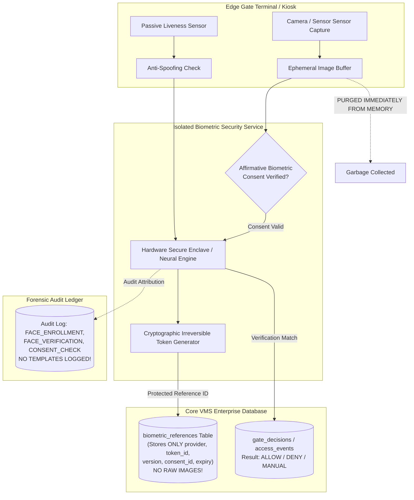

# VMS Enterprise: Biometric Security Architecture & Isolation Boundary

## 1. Architectural Isolation Philosophy

Biometric data (facial geometry vectors, fingerprint templates) represents the highest risk tier of personal identification. VMS Enterprise strictly isolates biometric processing behind a dedicated service boundary (`IBiometricProvider` and `BiometricSecurityService`).

### Key Invariants:
1. **Zero Raw Image Persistence**: Raw facial images captured at kiosks or enrollment stations are never permanently stored in the primary transactional database. Images are transformed into cryptographic, irreversible reference representations and immediately dropped from memory.
2. **Vendor-Neutral Hardware Abstraction**: The core application logic does not bind to any single camera vendor, ANPR supplier, or facial recognition SDK. All interactions traverse the `IBiometricProvider` contract.
3. **Controlled Categorical Output**: Raw floating-point confidence scores (e.g., `0.9412`) are never exposed to gate personnel or client apps. The boundary returns controlled operational classifications: `VERIFIED`, `NOT_VERIFIED`, or `MANUAL_REVIEW`.
4. **Mandatory Affirmative Consent**: Enrollment operations abort if a verified `BIOMETRIC_PROCESSING` consent record is missing.

---

## 2. Biometric Security Boundary Diagram (Section 64 - Diagram 7)



---

## 3. Face Verification Data Contract

When a gate verification occurs, the record generated is strictly minimized:

```typescript
export interface BiometricVerificationRecord {
  verificationId: string;
  tenantId: string;
  personId: string;
  transactionId?: string;
  provider: string;
  method: 'FACIAL_RECOGNITION' | 'LIVENESS_CHECK' | 'CARD_PLUS_FACE';
  livenessResult: boolean;
  matchResult: boolean;
  confidenceBand: 'VERIFIED' | 'NOT_VERIFIED' | 'MANUAL_REVIEW';
  timestamp: Date;
  device?: string;
  result: 'ALLOW' | 'DENY' | 'MANUAL_INSPECTION';
  failureReason?: string;
}
```

---

## 4. Biometric Retention & Lifecycle

- **Default Expiration**: Biometric references expire after a configurable period (default: 365 days) unless refreshed with renewed consent.
- **Immediate Right-to-Erasure**: Upon consent withdrawal or person profile archiving, `deleteReference()` revokes the template reference immediately and issues a `BIOMETRIC_REFERENCE_DELETED` audit event.
