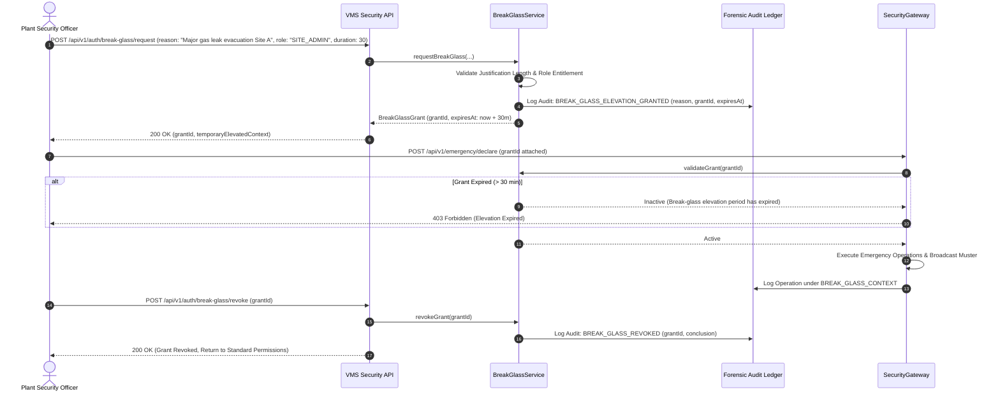

# VMS Enterprise: Emergency Break-Glass Access & Override Governance

## 1. Controlled Break-Glass Principles

In industrial plants, critical security incidents (e.g. fire alarms, chemical gas leaks, mass evacuations, active physical intruder breaches, edge network connectivity failures) require immediate operational overrides. VMS Enterprise provides a strictly controlled **Break-Glass Emergency Elevation Mechanism**:

1. **No Hidden Backdoors**: Break-glass access does not exist as an undocumented administrative backdoor. It is an explicit, auditable API workflow governed by the `BreakGlassService`.
2. **Mandatory Operational Justification**: Elevation requests must include a detailed operational justification (minimum 15 characters). Empty or frivolous requests are rejected.
3. **Hard Time Boundary**: Break-glass grants are capped at a maximum lifespan (default: 30 minutes; hard ceiling: 60 minutes). When the timer expires, elevated permissions terminate automatically.
4. **Dedicated Forensic Audit Trail**: Requesting, exercising, and revoking a break-glass grant generates prioritized tamper-evident audit records.

---

## 2. Break-Glass Emergency Elevation Flow



---

## 3. Data Schema & Invariant Enforcement

```typescript
export interface BreakGlassGrant {
  grantId: string;
  tenantId: string;
  userId: string;
  reason: string;
  elevatedRole: EnterpriseRole;
  requestedAt: Date;
  expiresAt: Date;
  revokedAt?: Date;
  auditRecordId: string;
  status: 'ACTIVE' | 'EXPIRED' | 'REVOKED';
}
```

### Post-Incident Review Invariant:
All actions taken under an active break-glass session are flagged in audit reports for mandatory dual-control compliance review by corporate security leadership.
