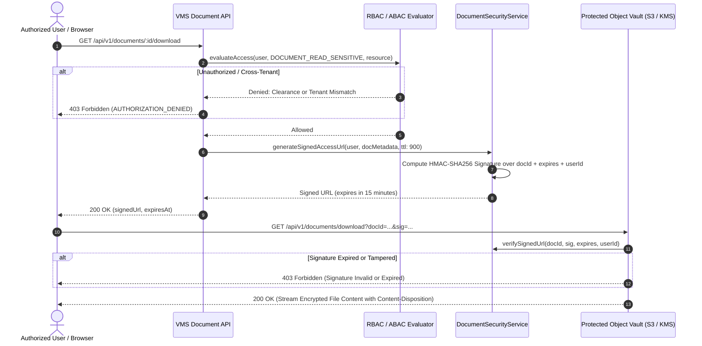

# VMS Enterprise: Document Security & Secure File Access

## 1. Document Access Security Principles

Enterprise visitor and contractor management involves confidential documentation: NDAs, government ID card scans, commercial invoices, hazardous work permits, and safety certifications. Under no circumstances are static or permanent public URLs exposed to clients or storage buckets.

### Controlled Access Lifecycle:
1. **Never Public**: Storage buckets (AWS S3, Google Cloud Storage, Azure Blob, MinIO) block all public read and write access.
2. **Ephemeral HMAC Signed URLs**: When an authorized user requests a document, the backend verifies tenant ownership and permissions, and issues a short-lived (default: 15 minutes) cryptographically signed URL.
3. **Signed Token Payload**: The signature binds the Document ID, Storage Key, Expiration Timestamp, and the Requesting User ID:
   $$\text{sig} = \text{HMAC-SHA256}(\text{Secret}, \text{docId} \parallel \text{storageKey} \parallel \text{expires} \parallel \text{userId})$$

---

## 2. Document Access Flow Diagram (Section 64 - Diagram 6)



---

## 3. File Upload Defense & Quarantine Architecture

All uploaded files undergo multi-stage deep validation before entering long-term storage:

1. **Size Boundary**: Max file size is capped at 25 MB. Larger payloads are rejected immediately at the gateway layer.
2. **MIME & Extension Whitelist**: Extensions must match verified MIME types strictly (`.pdf`, `.png`, `.jpg`, `.jpeg`, `.xlsx`, `.csv`). Executables (`.exe`, `.sh`, `.bat`, `.js`) are strictly forbidden.
3. **Magic Byte Verification**: File header bytes are examined in memory (e.g. `%PDF` for PDF, `0xFFD8FF` for JPEG, `0x89504E47` for PNG). Files with spoofed extensions are quarantined.
4. **Filename Sanitization**: Uploaded filenames are stripped of non-alphanumeric characters, eliminating path traversal risks (`../../etc/passwd`).
5. **Malware Scanning Hook**: Asynchronous workers pipe new uploads through anti-virus scanner abstractions (e.g., ClamAV) before unquarantining.

---

## 4. Configurable Retention Policies & Legal Holds

```typescript
export interface DocumentRetentionPolicy {
  policyId: string;
  tenantId: string;
  documentType: string;
  retentionDays: number;
  legalHold: boolean;
  actionOnExpiry: 'DELETE' | 'ARCHIVE' | 'ANONYMIZE';
}
```

### Legal Hold Invariant:
A document subject to a statutory audit, workplace accident investigation, or litigation can be flagged with a **Legal Hold Exception**. Even if the standard retention period (e.g., 90 days) elapses, the retention disposal engine strictly prevents silent purging, logging a `DISPOSAL_PREVENTED` exception event.
