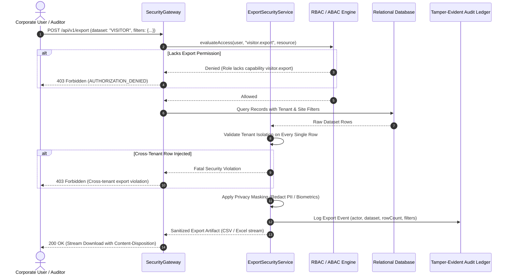

# VMS Enterprise: Export Security & Data Exfiltration Prevention

## 1. Export Security Principles

Data export features (e.g. CSV, Excel, PDF generation) represent a primary vector for intentional or accidental enterprise data exfiltration. VMS Enterprise strictly governs all export operations through the `ExportSecurityService`:

1. **Explicit Export Entitlements**: Generic read permissions (such as `visitor.read` or `audit.read`) do not automatically authorize mass data export. Dedicated permissions (e.g. `visitor.export`, `audit.export`, `esg.activity.export`) are strictly required.
2. **Mandatory Tenant & Site Boundary Filtering**: Export queries evaluate tenant ownership on every exported row. Cross-tenant records cannot be bundled into an export archive.
3. **Automated Data Minimization**: Export transformers apply the same privacy-by-design field masking as online interactive views. An ESG Manager exporting transport records receives distance and fuel consumption metrics, but personal KYC phone numbers and government IDs are stripped.
4. **Mandatory Forensic Export Audit**: Every export operation records an indelible audit log containing the requesting actor, dataset identifier, row count, filter criteria, and timestamp.

---

## 2. Export Security Flow Diagram (Section 64 - Diagram 9)



---

## 3. Forensic Export Audit Schema

```typescript
export interface ExportResult {
  exportId: string;
  datasetName: string;
  recordCount: number;
  exportedAt: Date;
  data: Array<Record<string, unknown>>;
  auditEvent: {
    exportId: string;
    actorUserId: string;
    datasetName: string;
    recordCount: number;
    filters: Record<string, unknown>;
    timestamp: Date;
  };
}
```
