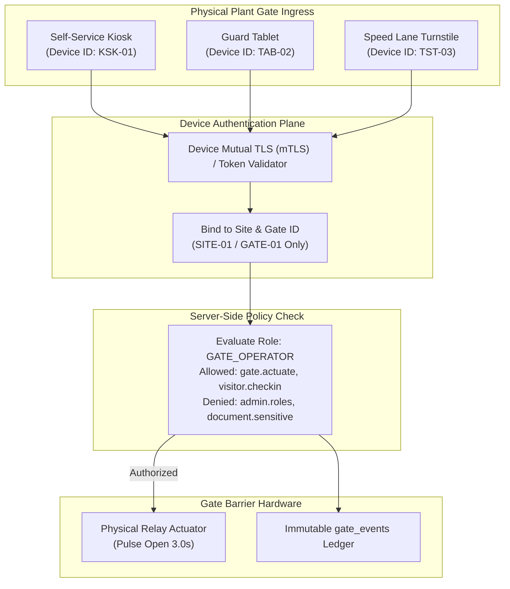
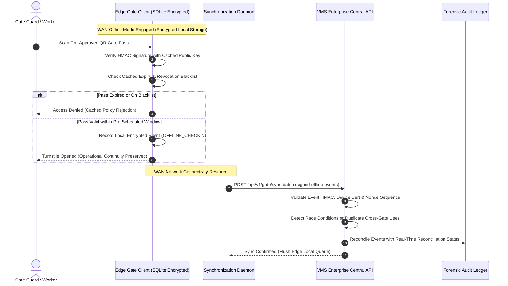

# VMS Enterprise: Gate Device Security & Offline Security Foundation

## 1. Physical Edge & Gate Device Security

Gate cabins, outdoor turnstiles, biometric speed lanes, security tablets, and self-service kiosks operate in semi-trusted physical environments. VMS Enterprise enforces device-aware security controls:

1. **Hardware Authentication**: Every edge terminal authenticates via unique device certificates / mutual TLS (mTLS) and hardware device identifiers.
2. **Least Privilege Gate Operators**: A `GATE_OPERATOR` or `SECURITY_GUARD` is granted fast-scan, pass verification, and gate actuation capabilities, but zero rights to alter roles, download private corporate contracts, or modify GHG accounting baselines.
3. **Device Context Tracking**: Every check-in and turnstile actuation records:
   - `deviceId`, `deviceType` (`GATE_TERMINAL`, `SECURITY_KIOSK`, `SECURITY_TABLET`), `gateId`, `siteId`, `appVersion`, and `networkSecurityState`.

---

## 2. Gate Device Security Flow Diagram (Section 64 - Diagram 10)

---

## 3. Offline Gate Security Foundation (Section 64 - Diagram 11)

In industrial facilities during WAN outages or network partition events, plant turnstiles must maintain safe, uninterrupted throughput without creating an unrestricted security bypass.

---

## 4. Offline Security Safeguards

1. **Encrypted Local Cache**: Edge devices store only cryptographic public keys, active daily appointment pass hashes, and active blacklists encrypted via SQLCipher using device hardware enclave keys.
2. **Strict Time-to-Live (TTL)**: Cached offline pass validations expire after a maximum window (e.g. 12 hours).
3. **No Unrestricted Bulk Data Caching**: Full employee identity history, contractor commercial contracts, and biometric neural vectors are NEVER synchronized or cached to edge gate tablets.
4. **Reconciliation & Anti-Passback Synchronization**: Upon reconnection, offline event batches are reconciled against central servers to detect double-entry, tailgating, or concurrent badge presentations across different perimeter gates.
