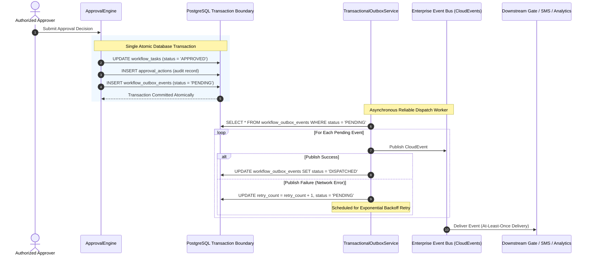

# Transactional Outbox Pattern & Event Reliability Architecture

## 1. Problem Statement: Dual-Write Hazard

In microservices and event-driven enterprise architectures, committing an operational state update to the relational database (e.g. updating an approval task to `APPROVED` or marking an entrance pass as granted) while simultaneously publishing an event over a network message broker (e.g., Kafka, RabbitMQ) introduces a dual-write hazard.

If the database commits but the network call fails, downstream systems (Gate turnstiles, notification SMS gateways, EHS dashboards) lose event synchronization. If the message broker receives the event but the database transaction rolls back, downstream systems act on phantom state.

---

## 2. Transactional Outbox Pattern Architecture

To guarantee atomicity and transactional integrity, VMS Enterprise implements the Transactional Outbox Pattern:

---

## 3. Reliability & Idempotency Invariants

| Invariant Code | Mechanism | Description |
|---|---|---|
| `OUTBOX-01` | **Atomic Write** | Outbox events are inserted into `workflow_outbox_events` in the exact same database transaction as the operational entity change. |
| `OUTBOX-02` | **At-Least-Once Delivery** | The dispatch worker retries transient failures up to 5 times with exponential backoff before marking an event as `FAILED` for dead-letter inspection. |
| `OUTBOX-03` | **Idempotent Consumers** | All domain events adhere to CloudEvents 1.0 with a unique `eventId` and `correlationId`. Consumers deduplicate messages using `eventId` keys, ensuring safety despite at-least-once delivery. |
| `OUTBOX-04` | **Multi-Tenant Isolation** | Outbox event records include mandatory `tenant_id`, guaranteeing tenant isolation during event queuing and dispatching. |
