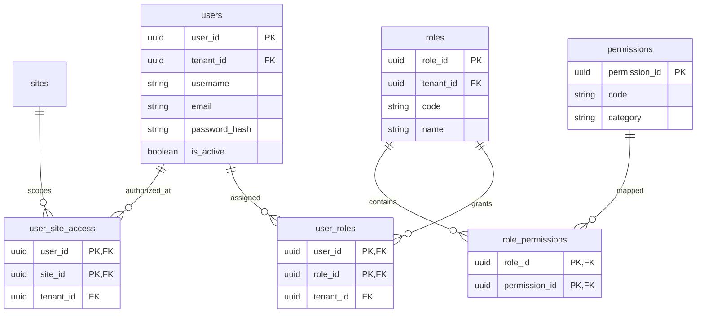
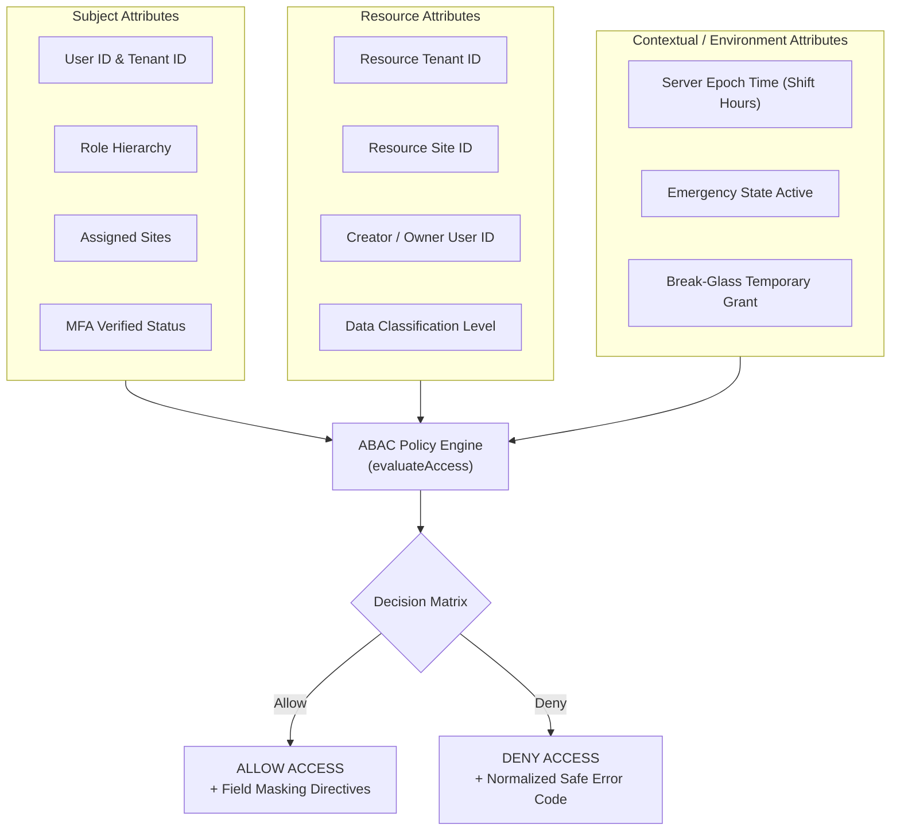

# VMS Enterprise: Hybrid RBAC + ABAC Security Architecture

## 1. Hybrid Model Philosophy

VMS Enterprise rejects single-column role checks (e.g., `is_admin = true`). Complex enterprise facilities require a **Hybrid RBAC + ABAC Architecture**:
- **Role-Based Access Control (RBAC)** establishes coarse-grained baseline capabilities and functional entitlements.
- **Attribute-Based Access Control (ABAC)** dynamically evaluates environmental attributes (tenant context, physical facility location, record ownership, data sensitivity classification, segregation of duties, and time of day) before granting access.

---

## 2. RBAC Model & Relational Topology Diagram (Section 64 - Diagram 4)

---

## 3. ABAC Evaluation Model Diagram (Section 64 - Diagram 5)

---

## 4. Comprehensive Role & Permission Matrix (18 Enterprise Roles)

| Role Code | Operational Scope | Key Granted Capabilities | Key Denied / Restricted Capabilities |
|---|---|---|---|
| `SUPER_ADMIN` | Global SaaS Operator | Full system administration, global tenant oversight | Direct customer operational PII unmasked by default |
| `ORGANIZATION_ADMIN` | Corporate VP / Director | Multi-site analytics, user governance, high-level approvals | Unmasked biometric vectors, physical gate actuation |
| `SITE_ADMIN` | Plant General Manager | Plant configuration, site emergency declare, gate topology | System settings of other sites/tenants |
| `SECURITY_MANAGER` | Plant Security Chief | Blacklist management, gate overrides, sensitive KYC verification | Commercial PO pricing, GHG methodology alteration |
| `SECURITY_GUARD` / `GATE_OPERATOR` | Gate Cabin Operator | Scan passes, actuate turnstiles, check-in visitors/vehicles | User role modification, contract downloads, GHG administration |
| `RECEPTIONIST` | Front Desk Lobby | Visitor pre-registration, badge printing, appointment check-in | Contractor work orders, gate actuation, material passes |
| `HOST` | Employee Host | Invite visitors, schedule appointments, approve visits | Other employees' appointments, gate actuation |
| `EHS_MANAGER` | Safety & Environment Officer | Permit-To-Work (PTW) approval, contractor safety audits, muster | Commercial pricing, gate turnstile actuation |
| `HR` / `HR_MANAGER` | Human Resources | Candidate pass creation, contractor induction compliance | Material challan approvals, security gate configuration |
| `LEGAL` / `LEGAL_USER` | Legal & Statutory Audit | NDA review, regulatory compliance, statutory audit access | Turnstile actuation, edge device configuration |
| `ESG_MANAGER` | Corporate Sustainability Lead | Scope 3 commuter transport analysis, GHG emission factor audits | **Government ID numbers, passport scans, biometric vectors** |
| `ESG_METHODOLOGY_ADMIN`| Chief Carbon Accountant | Emission factor versioning, Scope 1-3 mapping rule governance | Gate actuation, visitor appointment approvals |
| `AUDITOR` | External ISO / ESG Auditor | Read-only access to audit logs, calculations, and factor versions | Live pass actuation, record editing or deletion |
| `IT_ADMIN` | Enterprise IT Infrastructure | Edge gateway health, SSO settings, system diagnostic logs | Operational contractor and visitor business records |
| `MANAGEMENT` | Executive Leadership / CXO | Plant occupancy telemetry, high-level ESG dashboards | Granular pass generation, sensitive operational KYC |

---

## 5. Segregation of Duties (Dual-Control Invariants)

To prevent toxic authority combinations, the ABAC engine enforces segregation of duties:
1. **Self-Approval Prohibition**: The user who created an appointment, Permit-To-Work (PTW), or contractor work order cannot act as the sole approver (`actorUserId !== ownerId`).
2. **GHG Methodology Dual Control**: A user who introduces an updated emission factor cannot approve the calculation baseline independently.
3. **Privilege Escalation Defense**: An administrative user cannot elevate their own role to `SUPER_ADMIN` without an external break-glass or dual authorization workflow.
