# VMS Enterprise: Master Security Architecture & Core Framework

## 1. Security Philosophy: Defense-in-Depth & Zero Trust

VMS Enterprise operates at the mission-critical intersection of corporate identity, physical industrial security, statutory labor compliance, and ESG emission tracking. The platform enforces a strict server-side **Zero Trust** security architecture:

1. **Server-Side Enforcement**: Client-side state, UI button hiding, and route guarding are considered purely ergonomic UX conveniences. Security is strictly enforced server-side. Even if an attacker crafts raw HTTP API requests directly, unauthorized operations are rejected with a standardized authorization denial.
2. **Untrusted Client Tenant Context**: The client is never trusted to identify its own tenant, organization, or role. Every request resolves tenant membership from cryptographic session tokens verified against the database.
3. **Layered Defense**: Security is enforced across concentric layers: Authentication → Identity Resolution → Tenant Context Injection → RBAC Capabilities → ABAC Attribute & Scoping Constraints → Resource Access Verification → Segregation of Duties → Business Rule Validation → Field-Level Data Redaction → Tamper-Evident Audit.

---

## 2. Master Security Data-Flow Architecture (Section 65)

Every protected API transaction must navigate through the canonical nine-stage security pipeline:

```mermaid
flowchart TD
    User([Authenticated User / Client]) --> Auth[1. AUTHENTICATION\nValidate Session / Credentials / MFA]
    Auth --> Identity[2. IDENTITY RESOLUTION\nResolve User Record from DB]
    Identity --> TenantContext[3. TENANT CONTEXT\nDerive Tenant, Org, Assigned Sites/Gates\nIgnore Client-Supplied tenant_id]
    TenantContext --> Role[4. ROLE RESOLUTION\nResolve Enterprise Role Assignments]
    Role --> Permission[5. PERMISSION RESOLUTION\nMap Role to Granular Dot-Notation Permissions]
    Permission --> Resource[6. RESOURCE ACCESS CHECK\nVerify Tenant Boundary & Site Scoping]
    Resource --> ABAC[7. ATTRIBUTE / POLICY CHECK (ABAC)\nEvaluate Time, Sensitivity, Segregation of Duties]
    ABAC --> Decision{ALLOW or DENY?}
    Decision -- DENY --> SafeError[Safe Error Response: AUTHORIZATION_DENIED\nZero Internal / SQL Leakage]
    Decision -- ALLOW --> BusinessExec[Execute Business Domain Handler]
    BusinessExec --> Redact[8. DATA MINIMIZATION & REDACTION\nMask Government IDs, Phone, Biometrics]
    Redact --> Audit[9. TAMPER-EVIDENT FORENSIC AUDIT\nCryptographic SHA-256 Hash Chain]
    Audit --> ClientReturn([Secure Client Response])
```

---

## 3. High-Level System Architecture Diagram

```mermaid
flowchart LR
    subgraph Perimeter["Perimeter Security & Gateway"]
        TLS["TLS 1.3 Termination"]
        WAF["WAF & Rate Limiting Engine"]
        Headers["Security Headers (CSP, HSTS, X-Frame)"]
    end

    subgraph IdentityPlane["Identity & Access Plane"]
        Gateway["SecurityGateway"]
        SessionMgr["SessionSecurityService"]
        MfaEngine["MfaService (TOTP / Recovery)"]
        AbacEngine["RBAC + ABAC Evaluator"]
        BreakGlass["BreakGlassService"]
    end

    subgraph DataPlane["Data Isolation & Persistence Plane"]
        RLS["PostgreSQL 16+ Multi-Tenant RLS"]
        DocVault["Document Security Vault (Signed URLs)"]
        BioBoundary["Biometric Boundary (Hardware Mock / KMS)"]
        AuditLedger["Tamper-Evident Audit Ledger (SHA-256 Chained)"]
    end

    Perimeter --> IdentityPlane
    IdentityPlane --> DataPlane
```



---

## 4. Layered Security Model Specification

| Layer | Responsibility | Technology / Mechanism |
|---|---|---|
| **1. Transport & Ingress** | Encryption in transit, DoS prevention, browser protection | TLS 1.3, Strict CORS, Sliding-Window Rate Limiter, HTTP Security Headers |
| **2. Authentication** | Identity proofing, credential validation, multi-factor authentication | PBKDF2-SHA512 password hashing, RFC 6238 TOTP, single-use recovery codes, account lockout |
| **3. Session Security** | State tracking, fixation defense, lifecycle termination | Server-side session tokens, 30-min inactivity timeout, 12-hr absolute expiration, session rotation |
| **4. Multi-Tenant Isolation** | Strict isolation between corporate entities | Authenticated tenant context injection, PostgreSQL Row-Level Security, defense-in-depth repo guards |
| **5. Authorization (RBAC)** | Role baseline capabilities | 18 Enterprise Roles, dot-notation permissions (`visitor.read`, `contractor.approve`) |
| **6. Authorization (ABAC)** | Contextual and attribute constraints | Site scoping, gate assignment, time windows, data classification levels |
| **7. Segregation of Duties** | Prevent dual-control bypasses | Creator cannot approve own documents, PTW permits, or emission factors |
| **8. Data Classification & Privacy** | Protect confidential records and PII | 5-level classification, phone masking (`******1234`), government ID masking (`XXXX-XXXX-1234`) |
| **9. Document Security** | Prevent unauthorized file exfiltration | Magic-byte validation, quarantine state, short-lived signed URLs, legal hold retention protection |
| **10. Biometric Security** | Isolate facial recognition data | Zero raw image storage in core DB, hardware provider abstraction, irreversible reference tokens |
| **11. Audit & Traceability** | Forensic accountability and non-repudiation | Append-only database table, SHA-256 cryptographic chaining, real-time security alerting |
| **12. Emergency Override** | High-severity incident operational access | Break-glass elevation with mandatory justification, strict time limit, and dedicated audit trail |
