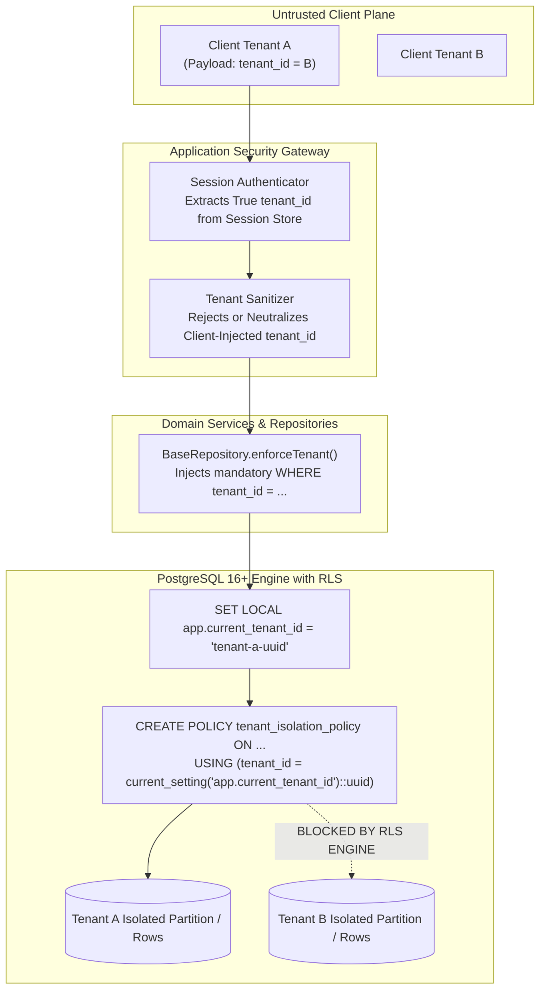

# VMS Enterprise: Multi-Tenant Isolation & Row-Level Security (RLS)

## 1. Multi-Tenant SaaS Isolation Principles

VMS Enterprise operates as a multi-tenant enterprise SaaS platform hosting competing industrial corporations on shared infrastructure. Under no circumstances may Tenant Alpha inspect, query, or infer data belonging to Tenant Beta.

### Core Isolation Invariants:
1. **Never Trust Client-Sent Tenant ID**: The `tenant_id` header or body parameter sent by an HTTP client is strictly considered untrusted user input. Tenant context is derived exclusively from the authenticated session record stored server-side.
2. **Defense-in-Depth Isolation**: Tenant isolation is enforced at three independent architectural layers:
   - **Layer 1: SecurityGateway**: Validates that request URLs and payload tenant references match the authenticated context.
   - **Layer 2: BaseRepository & ORM**: Injects tenant filtering on every query (`WHERE tenant_id = :current_tenant_id`).
   - **Layer 3: PostgreSQL 16+ Row-Level Security (RLS)**: Enforces database engine-level kernel filtering via PostgreSQL session variables (`SET LOCAL app.current_tenant_id = '...'`).

---

## 2. Tenant Isolation Topology Diagram (Section 64 - Diagram 3)



---

## 3. PostgreSQL 16+ Row-Level Security (RLS) Schema Architecture

All multi-tenant relational tables in PostgreSQL are created with forced row-level security enabled:

```sql
-- Enable Row Level Security on the table
ALTER TABLE visitor_transactions ENABLE ROW LEVEL SECURITY;
ALTER TABLE visitor_transactions FORCE ROW LEVEL SECURITY;

-- Define tenant isolation policy
CREATE POLICY visitor_transactions_tenant_isolation ON visitor_transactions
    AS RESTRICTIVE
    FOR ALL
    TO vms_app_user
    USING (
        tenant_id = NULLIF(current_setting('app.current_tenant_id', true), '')::UUID
    )
    WITH CHECK (
        tenant_id = NULLIF(current_setting('app.current_tenant_id', true), '')::UUID
    );
```

### Connection Pooling Best Practice:
When using connection poolers (e.g., PgBouncer), tenant context is set on a per-transaction basis using transaction-scoped settings:

```sql
BEGIN;
SET LOCAL app.current_tenant_id = '00000000-0000-0000-0000-000000000001';
-- Queries executed within transaction are strictly scoped to Tenant A
SELECT * FROM visitor_transactions;
COMMIT;
-- Setting automatically clears on commit / rollback, eliminating pool contamination risks.
```

---

## 4. Tenant Boundary Verification Matrix

Every protected query verifies three nested boundary conditions:
1. `record.tenant_id === context.tenant_id`
2. `record.site_id === context.site_id` (if the role is physically site-bounded, such as gate operators)
3. `record.classification` clearance matches the requesting identity.

Even if an attacker guesses a valid UUID belonging to another corporation (`GET /api/v1/visitors/tx-0000-other-tenant`), the query returns `403 AUTHORIZATION_DENIED` or `404 RESOURCE_NOT_FOUND`, preventing IDOR (Insecure Direct Object Reference) exploits.
