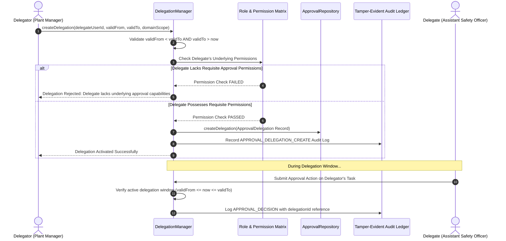

# Workflow Security, Delegation & Permission Transfer Boundaries

## 1. Executive Summary

In enterprise manufacturing environments, managers frequently travel or take leave. The Approval Delegation framework allows authorized approvers to delegate their sign-off authority to a qualified colleague for a strictly bounded time window.

To prevent privilege escalation, delegation is not an arbitrary assignment: **the delegate must independently possess the underlying approval permissions** required to execute the sign-off. A user cannot gain elevated permissions simply by being named a proxy by another employee.

---

## 2. Delegation Authorization & Permission Transfer Boundary

---

## 3. Delegation Invariants & Security Rules

| Rule Code | Security Requirement | Enforcement |
|---|---|---|
| `SEC-DEL-01` | **No Privilege Escalation**: A delegate must already possess underlying approval permission (e.g. `visitor.approve`, `contractor.approve`) for their role. | `DelegationManager.createDelegation()` |
| `SEC-DEL-02` | **Strict Time-Bounding**: Delegations must have explicit `validFrom` and `validTo` timestamps. Indefinite delegations are prohibited. | Timestamp check |
| `SEC-DEL-03` | **Early Revocation**: Delegations can be revoked at any time by the delegator or a Super Admin, taking effect immediately. | `DelegationManager.revokeDelegation()` |
| `SEC-DEL-04` | **Provenance Audit Trail**: When a delegate acts on a task, the resulting `ApprovalActionRecord` permanently records `actorUserId = delegate.id` AND `delegationId = del.id`. Acting as a proxy does not mask the actual actor. | Audit ledger binding |
| `SEC-DEL-05` | **Domain Scoping**: Delegations can be scoped to specific domains (e.g. Visitor only, or Contractor only) or site facilities. | Domain scope checking |
