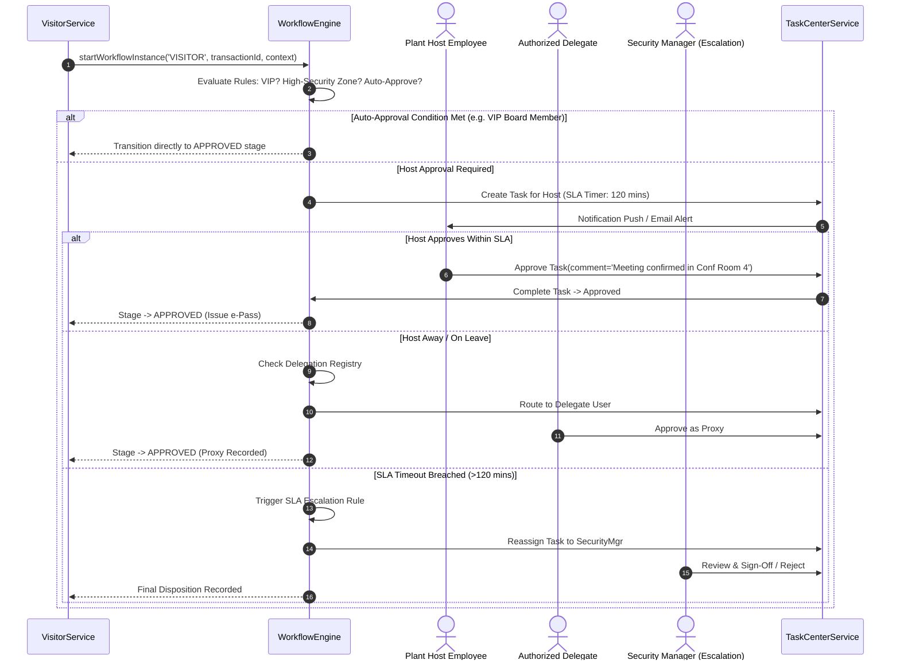

# Workflow Approval Integration & SLA Escalation

## 1. Overview

Visitor transactions integrate directly with the enterprise **Workflow Engine** (`@vms/workflow`) established in Part 5. Approvals are not hardcoded inside UI screens or monolithic database triggers; rather, visit submissions instantiate a versioned workflow instance bound to the plant site's published workflow template.

---

## 2. Approval Integration & Escalation Diagram

---

## 3. Configurable Approval Policies

Plant sites configure approval policies based on transaction context:

1. **Standard Visit**: 1-tier approval by the host employee.
2. **Hazardous / Production Floor Access**: 2-tier approval (Tier 1: Host; Tier 2: EHS Safety Officer).
3. **VIP / Executive Delegation**: Accelerated auto-approval with notification broadcast to Plant Head and Corporate Security.
4. **Restricted Zone / Cleanroom**: 3-tier sequential approval (Host → Facility Head → Plant Security Officer).

---

## 4. Delegation & Proxy Governance

To prevent gate deadlocks when hosts are travelling or on leave:
- Employees configure active delegations (`validFrom`, `validTo`, `delegateUserId`).
- When a visitor registers with an absent host, the task automatically routes to the configured delegate.
- The system logs both the primary host and proxy approver in the immutable workflow history for auditing.
