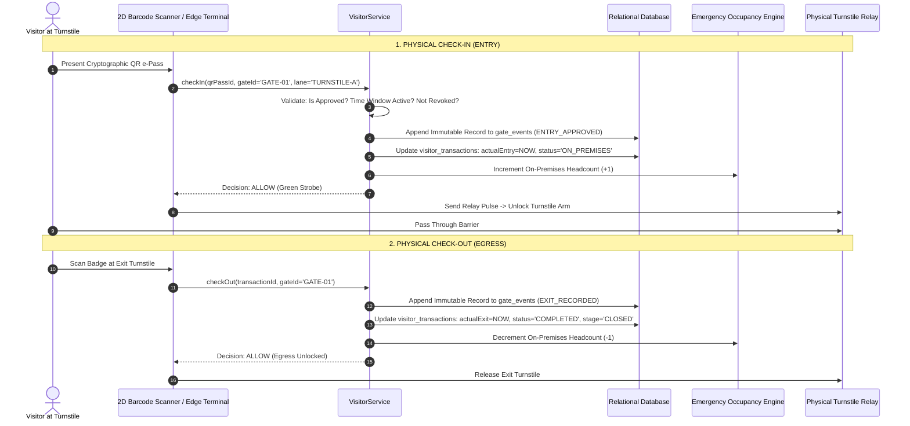

# Physical Gate Operations: Check-In, Check-Out & Immutable Events

## 1. Overview

The physical perimeter of an industrial plant features turnstiles, optical speed lanes, boom barriers, UHF RFID readers, and 2D barcode scanners. 

Physical gate execution is strictly decoupled from high-level business workflow logic:
- **Business Workflow Engine**: Determines *eligibility* (Is this visit approved by the host and safety team?).
- **Gate Execution Engine**: Determines *physical admittance* (Is this person at the right turnstile, at the right time, with an active valid credential?).

---

## 2. Gate Event Flow Diagram



---

## 3. Immutable Gate Event Schema

Gate events represent a cryptographically verifiable append-only ledger:

```typescript
export interface GateEvent {
  id: string; // UUIDv4
  tenantId: string;
  siteId: string;
  gateId: string;
  laneId?: string;
  sourceDomain: 'VISITOR' | 'CUSTOMER' | 'CONTRACTOR' | 'MATERIAL' | 'VEHICLE';
  sourceTransactionId: string;
  eventType: 'ENTRY_REQUESTED' | 'ENTRY_APPROVED' | 'ENTRY_DENIED' | 'ZONE_TRANSIT' | 'EXIT_RECORDED';
  credentialType: 'QR_EPASS' | 'RFID_BADGE' | 'BIOMETRIC_FACE' | 'MANUAL_OVERRIDE';
  decision: 'ALLOW' | 'DENY';
  denialReason?: string;
  actorId: string; // Guard ID or Edge Device Serial
  occurredAt: string; // ISO 8601 UTC
}
```

Historical gate events are **never updated or soft-deleted**. In the event of a bad scan or manual correction, a compensatory counter-event is appended with audit linkage.

---

## 4. Emergency Muster Synchronization

Every `checkIn` and `checkOut` event drives live emergency occupancy data:
- Check-in increments the plant headcount and registers the visitor on the live muster roll-call list.
- Check-out immediately decrements the headcount.
- If an emergency evacuation siren triggers, the plant emergency dashboard reads directly from the real-time active visitor roster without needing table scans.
