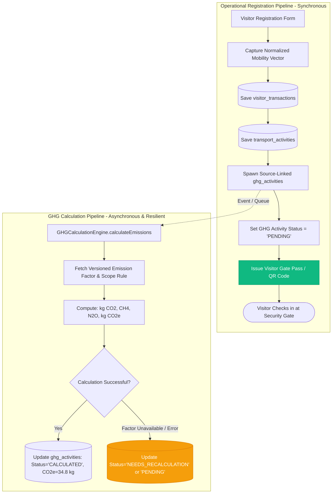

# Embedded ESG Activity Capture & Carbon Decoupling

## 1. Executive Summary

A core architectural pillar of VMS Enterprise is that **ESG and GHG activity capture is an embedded, cross-cutting capability** within operational business transactions—not an isolated reporting dashboard or an after-the-fact manual survey.

When a visitor registers, the operational activity data automatically generates a source-linked GHG activity record. Crucially, the **operational registration never fails or halts if emission factor lookups or calculations are delayed, offline, or fail**.

---

## 2. Decoupled Architecture Diagram

---

## 3. Operational Resilience Invariant

| Scenario | Operational Impact | ESG Record State | User Experience |
|:---|:---|:---|:---|
| **Standard Online** | Visit created in <1s; e-Pass issued. | `CALCULATED` with full CO2e values. | Instant pass issuance; badge displays verified sustainability tag. |
| **Emission Factor Offline** | Visit created in <1s; e-Pass issued. | `PENDING`; queued for background processing. | Visit operates normally; carbon ledger updates automatically later. |
| **Calculation Engine Crash** | Visit created in <1s; e-Pass issued. | `NEEDS_RECALCULATION`; flagged for retry. | **Zero interruption** to gate security or visitor check-in. |

---

## 4. Automatic Scope 3 Category Mapping

Operational users never encounter confusing accounting terminology like "Scope 3 Category 6: Business Travel" or "Category 7: Employee / Visitor Commuting". 

Instead, the **Scope Mapping Rules Engine** evaluates business rules:
- `visitorCategory in ('CONSULTANT', 'AUDITOR', 'GOVERNMENT_OFFICIAL')` $\rightarrow$ Scope 3, Category 6: **Business Travel**.
- `visitorCategory in ('INTERVIEW_CANDIDATE', 'COMMUNITY', 'FAMILY')` $\rightarrow$ Scope 3, Category 7: **Commuting / Other Third-Party Travel**.
- `vehicleOwnership == 'COMPANY'` $\rightarrow$ Scope 1: **Direct Mobile Combustion** (if company fleet fuel consumed).
