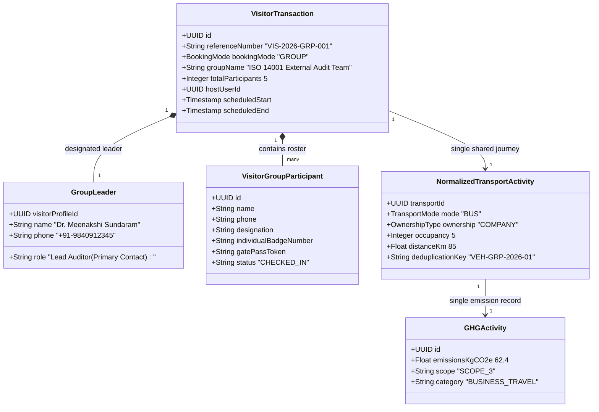

# Group Delegations & Transport Deduplication

## 1. Overview

Corporate plant tours, regulatory inspection delegations, OEM vendor audits, and academic visits typically arrive as **Groups** sharing a common schedule, host, purpose, and vehicular transport (e.g. chartered bus, tempo traveler, shared SUV).

Registering group participants individually creates severe operational bottlenecks and, critically, **corrupts ESG Scope 3 commuter calculations** by multiplying vehicular trip emissions across every passenger.

---

## 2. Group Delegation Architecture Diagram

---

## 3. Operational Invariants for Group Visits

1. **Roster Bulk Ingestion**: Organizers or hosts can upload group rosters via CSV/Excel or enter them line-by-line. Roster fields: Name, Phone, Email, Company, Govt ID type/number.
2. **Individual Badge & Pass Generation**: Every participant receives their own personalized QR code e-Pass and printed gate badge for physical access tracking and emergency muster accountability.
3. **Emergency Muster Fidelity**: In an evacuation, every participant is an individual occupancy count, ensuring accurate missing persons headcounts.
4. **Transport Deduplication Guarantee**:
   - The shared transport vector (e.g. 1 chartered diesel bus travelling 85 km) is recorded **once** at the group transaction header.
   - Occupancy is populated with the participant count (`occupancy = 5`).
   - The system attributes the vehicle's fuel burn once rather than generating 5 separate 85 km bus journeys.
   - Individual emissions per visitor are calculated as $\text{Total Trip Emissions} / \text{Occupancy}$ for internal allocation.
