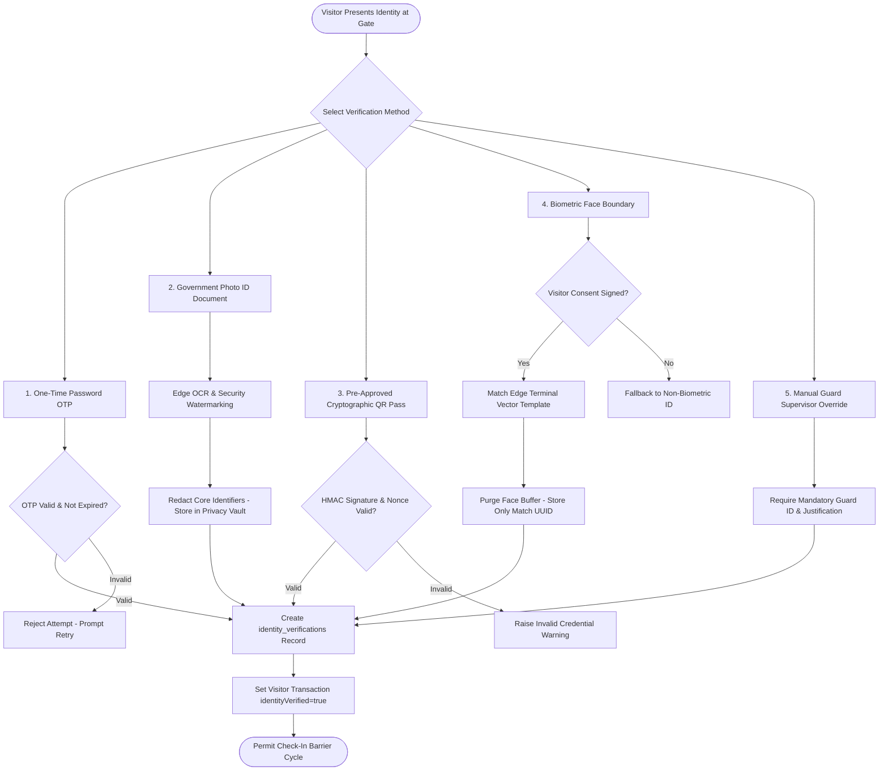

# Identity Verification & Privacy Pipeline

## 1. Overview

Identity verification at enterprise manufacturing facilities must balance strong security perimeter requirements against legal compliance, data privacy (e.g. DPDP Act, GDPR), and operational speed. 

The **Identity Verification Pipeline** supports multi-modal identity validation methods without exposing raw personal identity documents or permanent biometric records to unauthorized operators.

---

## 2. Identity Verification Pipeline Diagram

---

## 3. Supported Verification Methods

| Method Code | Description | Operational Use Case |
|:---|:---|:---|
| `OTP` | 6-digit cryptographic SMS/email code with 5-minute TTL. | Remote pre-registration, self-service kiosk check-in. |
| `GOVT_ID_DOCUMENT` | National Identity Card (Aadhaar, PAN, Passport, Driving License). | Industrial security gate desk initial registration. |
| `APPOINTMENT_QR` | Opaque signed QR barcode presented on smartphone or printed pass. | Fast-track turnstile entry for pre-approved guests. |
| `BIOMETRIC_FACE_BOUNDARY` | Ephemeral edge facial feature extraction; zero persistent image storage. | High-security cleanrooms, R&D labs, data centers. |
| `MANUAL_VERIFICATION` | Physical verification by Security Officer with badge badge inspection. | Network degradation, VIP expedited protocol, system downtime. |

---

## 4. Privacy & Data Minimization Protocol

1. **No Raw PII in Barcodes**: QR codes issued to visitors carry zero plaintext personal identifiers (no names, phones, or ID numbers). Barcodes contain solely an opaque HMAC-SHA256 signed token.
2. **Biometric Privacy Boundary**: Raw camera frames and photographic face images are never uploaded to central PostgreSQL transactional databases. Matching occurs at the edge, and the central system stores only a transient vendor-agnostic reference UUID.
3. **Data Retention & Auto-Purge**: Identity verification images and OCR buffers are bound to the tenant's data retention policy (default: auto-purged 30 days post-visit).
