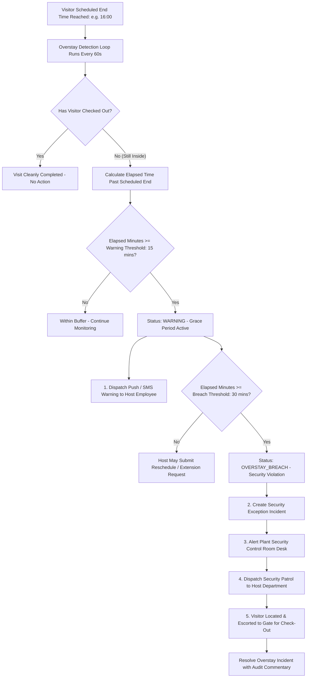

# Overstay Breach Detection & Security Dispatch Loop

## 1. Overview

In industrial manufacturing facilities (chemical compounding, rubber extrusion, assembly lines, smelting units), unauthorized individuals lingering past their scheduled departure window pose severe physical security, industrial espionage, and EHS safety risks.

The **Overstay Detection Engine** monitors on-premises visitors against their authorized schedule and dispatches automated escalations when boundaries are breached.

---

## 2. Overstay Escalation Loop Diagram

---

## 3. Threshold Configuration

Overstay parameters are configured per site or security zone:

| Threshold Tier | Default Offset | Actions Triggered |
|:---|:---|:---|
| **Early Notice** | -15 minutes before end | SMS alert to host: "Visitor meeting scheduled to conclude in 15 mins." |
| **Warning Threshold** | +15 minutes past end | Host alerted; visitor prompted on smartphone to request visit extension. |
| **Breach Threshold** | +30 minutes past end | Critical banner rendered on top of Security Dashboard; incident logged. |
| **Severe Escort Breach** | +60 minutes past end | Physical security patrol dispatched; turnstile credential auto-restricted for egress only. |

---

## 4. Operational Extension Protocol

If a meeting is legitimately running late:
1. The host clicks **Request Extension** from their Task Center or SMS link.
2. The host specifies an updated end time (e.g. +60 minutes) and mandatory business justification.
3. The engine increments the visit transaction version (`version++`), clears the active warning state, updates the e-Pass expiration timestamp, and logs the change to `audit_logs`.
