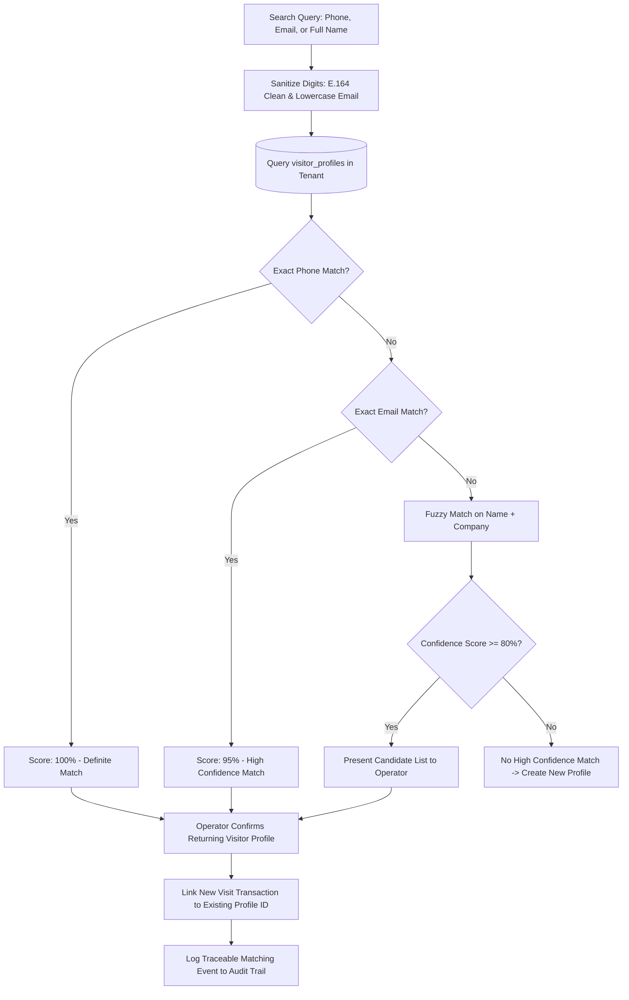

# Returning Visitor Disambiguation & Profile Resolution

## 1. Overview

In industrial manufacturing operations, frequent visitors (contract auditors, logistics brokers, equipment field service engineers, and regular suppliers) return dozens of times per year. Creating duplicate master profiles causes fragmented audit trails, inaccurate historical reporting, and unnecessary administrative burden.

The **Returning Visitor Resolution Engine** deterministically identifies repeat visitors while avoiding accidental cross-profile contamination when individuals share names or corporate domains.

---

## 2. Disambiguation Flow Diagram

---

## 3. Disambiguation Scoring Model

Candidate matches are scored dynamically using a 4-tier weighting algorithm:

| Match Criterion | Match Type | Weight / Score | Resolution Behavior |
|:---|:---|:---|:---|
| **Cleaned Phone Number** | Exact match on 10-digit suffix | **100%** | Auto-select profile; prompt operator to confirm. |
| **Email Address** | Exact case-insensitive match | **95%** | Auto-populate profile; prompt operator to confirm. |
| **Name + Company** | Levenshtein distance <= 2 | **80%** | Display candidate card with masked phone/email. |
| **Name Only** | Phonetic / partial string match | **40%** | Display ambiguous warning; require phone verification. |

---

## 4. Privacy & Masking Safeguards

When presenting candidates to security desk operators:
- **Phone Number Masking**: Formatted as `+91-XXXXX-11223` to preserve privacy against shoulder surfing.
- **Govt Identification Numbers**: Strictly redacted (e.g. `AADHAAR: **** **** 4892`, `PAN: *****124A`).
- **Blacklist & Alert Tags**: If an existing profile carries an active security watchlist flag or site barring notice, the system immediately highlights a critical restriction banner and alerts the Security Control Room.
