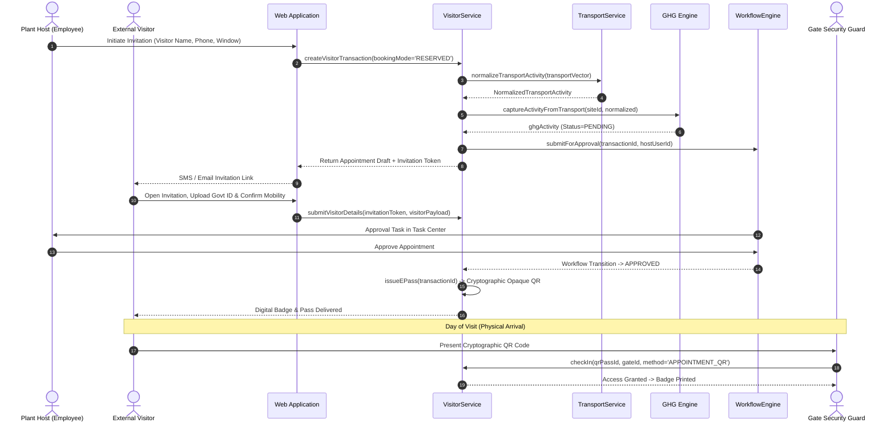

# Reserved Booking & Pre-Registration Workflow

## 1. Overview

**Reserved Booking** represents the scheduled pre-registration pathway used for corporate appointments, supplier meetings, OEM audits, and job candidate interviews. It enables advanced host approval, preliminary identity checks, safety pre-inductions, and QR e-Pass distribution prior to physical arrival.

---

## 2. Sequence Flow Diagram

---

## 3. Pre-Registration Data Contract

Reserved pre-registration captures:
- **Demographic Information**: Full name, mobile number (E.164), email address, organization/company, job title.
- **Visit Context**: Host employee reference, plant site identifier, authorized entry gate, scheduled start time, scheduled end time, visit purpose.
- **Embedded Transport Vector**: Origin city/landmark, destination facility, transport mode (e.g. `CAR`, `TRAIN`, `FLIGHT`), vehicle ownership (`PERSONAL`, `COMPANY`, `HIRED`), fuel type, occupancy, journey direction.
- **Compliance & Security Prerequisites**: Required security escort flag, high-security zone access request, safety induction status.

---

## 4. Invitation Link Lifecycle

1. **Token Generation**: Secure HMAC-SHA256 nonces with configurable expiration (default: scheduled start time + 4 hours).
2. **One-Time Access**: Nonces cannot be replayed once visitor details are submitted and verified.
3. **Rescheduling / Cancellation**: If the host reschedules or cancels, the token is invalidated immediately and a replacement invitation link is issued.
