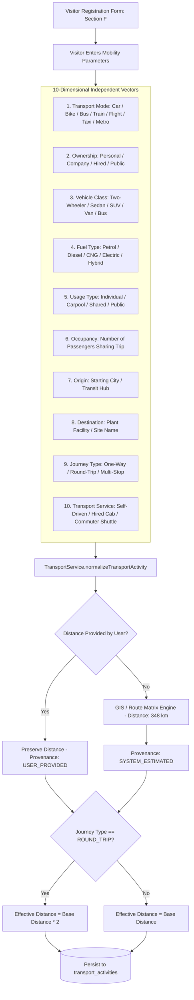

# Embedded Transport Mobility Vector & Distance Derivation

## 1. Overview

Rather than capturing an overly simplistic dropdown like `Transport = Car`, VMS Enterprise captures a **10-dimensional normalized mobility vector** embedded directly inside the visitor registration workflow. This ensures rigorous Scope 3 GHG carbon calculations without burdening the visitor with carbon accounting jargon.

---

## 2. Mobility Capture & Normalization Flow

---

## 3. Independent Dimensional Dimensions

The platform strictly avoids hard-coding rigid permutations (e.g. `Own Diesel Car`, `Company Electric Bus`). Each dimension is independent:

| Dimension | Permitted Enumerations / Data Contract |
|:---|:---|
| **Mode** | `CAR`, `TWO_WHEELER`, `BUS`, `TRAIN`, `FLIGHT`, `TAXI_CAB`, `AUTO_RICKSHAW`, `VAN`, `WALKING`, `OTHER` |
| **Ownership** | `PERSONAL`, `COMPANY`, `HIRED`, `PUBLIC`, `SUPPLIER`, `CUSTOMER`, `OTHER` |
| **Vehicle Class** | `TWO_WHEELER`, `SEDAN`, `SUV`, `VAN`, `BUS`, `UNKNOWN` |
| **Fuel Type** | `PETROL`, `DIESEL`, `CNG`, `ELECTRIC`, `HYBRID`, `NOT_APPLICABLE` |
| **Usage Type** | `INDIVIDUAL`, `CARPOOL`, `SHARED`, `PUBLIC_COMMUTE` |
| **Occupancy** | Positive Integer (e.g. `1` for solo, `4` for carpool) |
| **Journey Type** | `ONE_WAY`, `ROUND_TRIP`, `MULTI_STOP`, `LOCAL` |
| **Service Type** | `SELF_DRIVEN_PERSONAL`, `COMPANY_PROVIDED_CAB`, `HIRED_TAXI_CAB`, `PUBLIC_COMMUTER_TRANSIT` |

---

## 4. Automatic GIS Distance Derivation

When an origin city or landmark is supplied (e.g. `Bengaluru` to `Chennai Radial Tyre Plant`):
1. **Route Engine Derivation**: The system looks up standard road distances from the facility transit matrix (e.g. 348 km).
2. **Provenance Tagging**: The value is explicitly labeled `SYSTEM_ESTIMATED`.
3. **Editable Confirmation**: The visitor or receptionist can override the estimated distance. If edited, the provenance tag updates to `USER_PROVIDED`.
4. **Round-Trip Handling**: When `journeyType === 'ROUND_TRIP'`, the engine automatically doubles the one-way distance to account for outbound and return emissions.
