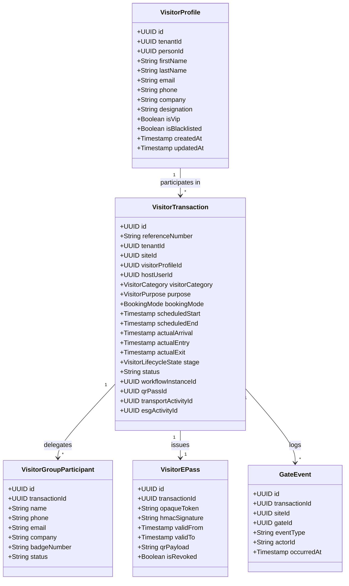

# Visitor Domain Architecture & Boundaries

## 1. Executive Summary

The **Visitor Management Domain** (`@vms/visitor`) provides mission-critical visitor governance for multi-site industrial manufacturing plants, corporate complexes, and logistics hubs. Operating within the VMS Enterprise ecosystem, the domain governs the intake, vetting, approval, physical gate entry, and exit of external visitors while enforcing strict domain isolation and embedding automated ESG Scope 3 transport activity capture.

---

## 2. Fundamental Architectural Principles

### 2.1 Domain Independence
Visitor Management is an **independent business pipeline**, not a universal parent entity. 
- Customers, Contractors, OEM Service Technicians, Materials, and Commercial Freight Vehicles own separate lifecycles, database entities, and workflows.
- A visitor transaction references shared platform capabilities (Identity, Documents, Transport, Workflow, Access, Gate, Events, and Audit) without leaking domain assumptions.

### 2.2 Strict Profile vs. Transaction Separation
A fundamental design flaw in legacy VMS applications is conflating a person's master identity with an individual visit. VMS Enterprise enforces strict relational separation:
- `visitor_profiles`: The long-lived identity master containing immutable personal demographics, contact identifiers, company affiliation, verification status, and biometric references.
- `visitor_transactions`: The temporal, site-specific visit occurrence containing the host assignment, purpose, schedule, stage, status, gate pass, transport vectors, and activity links.

A visitor profile may participate in dozens of transactions across multiple manufacturing facilities over years without redundant profile records.

---

## 3. Domain Entity Model

---

## 4. Multi-Tenant & Multi-Site Isolation

Every database table in the Visitor domain mandates a `tenant_id` foreign key. Security and isolation are enforced in-depth:
1. **Application Context**: `VisitorService` requires an active `tenantId` on every operation. Cross-tenant access throws an explicit `TenantIsolationError`.
2. **Database Row-Level Security (RLS)**: PostgreSQL session settings set `app.current_tenant_id` on every connection checkout, preventing cross-tenant leakage even if SQL injection occurs.
3. **Site Scoping**: Operational staff (e.g. Security Guards and Receptionists) are bounded by `siteId`. Corporate Management and Auditors can review cross-facility operations across Chennai, Pune, and Jamshedpur plants.

---

## 5. Architectural Boundaries & Dependencies

| External Subsystem | Relationship & Boundary Contract |
|:---|:---|
| **Identity & KYC** | Abstracted via `PersonService`. Raw government photo IDs and biometric templates are stored in secure privacy vaults; the visitor transaction references only verified status and document UUIDs. |
| **Workflow Engine (Part 5)** | Visitor transactions delegate multi-tier host, department head, and EHS safety approvals to `@vms/workflow`. |
| **Transport Normalization** | Transport parameters entered during visitor booking are routed to `TransportService` to generate a 10-dimensional normalized transport record. |
| **ESG / GHG Engine** | Normalized mobility activities automatically spawn `ghg_activities` via `GHGCalculationEngine`. Operational registration never halts if GHG calculation is pending or delayed. |
| **Physical Gate Infrastructure** | Edge turnstiles and barcode scanners communicate via asynchronous adapter APIs, posting verified scans into immutable `gate_events`. |
