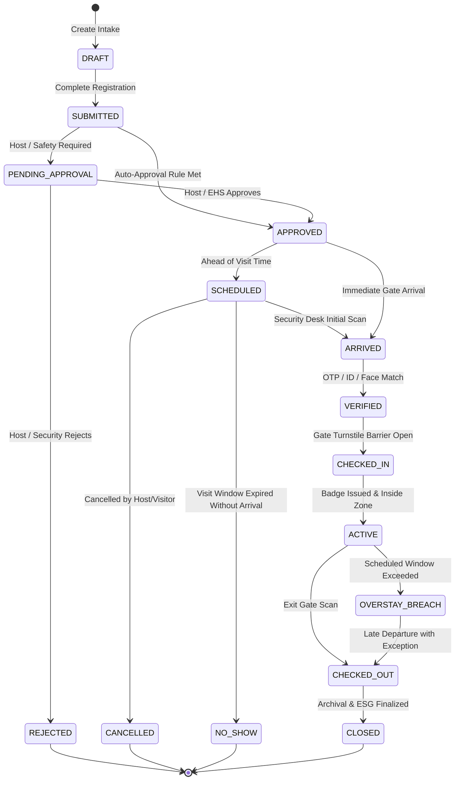

# Visitor Transaction Lifecycle & State Transitions

## 1. Overview

The **Visitor Transaction Lifecycle** governs the end-to-end progression of a visit from initial pre-registration through physical gate departure and archival. The system strictly separates **Stage** (current operational phase) from **Status** (qualitative disposition within that phase) to prevent state conflation.

---

## 2. Lifecycle State Machine Diagram

---

## 3. Stages vs. Statuses

| Stage | Permitted Statuses | Description |
|:---|:---|:---|
| `DRAFT` | `DRAFT` | Form being filled, not yet submitted for host review. |
| `SUBMITTED` | `PENDING` | Validated and persisted; queued for workflow routing. |
| `PENDING_APPROVAL` | `PENDING`, `ESCALATED` | Awaiting host or EHS manager digital sign-off. |
| `APPROVED` | `APPROVED` | All workflow stages passed. QR e-Pass token issued. |
| `SCHEDULED` | `CONFIRMED` | Confirmed future visit; waiting for visit date/time. |
| `ARRIVED` | `IN_PROGRESS` | Visitor is physically present at security gate desk. |
| `VERIFIED` | `CONFIRMED` | Government photo ID / OTP / biometric check passed. |
| `CHECKED_IN` | `ON_PREMISES` | Entry turnstile cycled; active inside plant. |
| `ACTIVE` | `ON_PREMISES`, `WARNING`, `BREACH` | Active on site; monitored for overstay thresholds. |
| `CHECKED_OUT` | `CHECKED_OUT` | Egress turnstile scanned; visitor departed facility. |
| `CLOSED` | `COMPLETED` | Visit finalized; carbon ledger reconciliation complete. |
| `TERMINAL` | `REJECTED`, `CANCELLED`, `EXPIRED`, `NO_SHOW`, `BLOCKED` | Non-operational terminal states. |

---

## 4. Transition Invariants & Guard Rules

1. **Approval Invariant**: No visitor with `bookingMode === 'WALK_IN'` or `'RESERVED'` can transition to `CHECKED_IN` if `status === 'PENDING'` or `'REJECTED'`.
2. **Duplicate Check-In Guard**: An active visitor (`status === 'ON_PREMISES'`) cannot be checked in again without an intervening `CHECKED_OUT` event.
3. **Cancellation Guard**: An active visitor currently inside the facility (`CHECKED_IN` or `ACTIVE`) cannot be cancelled or rescheduled. They must exit first.
4. **Idempotency**: Submitting a transaction or recording a gate scan with an identical idempotency key returns the existing transition without executing duplicate side-effects.
5. **Traceability Guarantee**: Every stage transition records an immutable row in `audit_logs` and emits a domain event (`VISITOR_STAGE_TRANSITIONED`, `GATE_CHECKIN_COMPLETED`).
