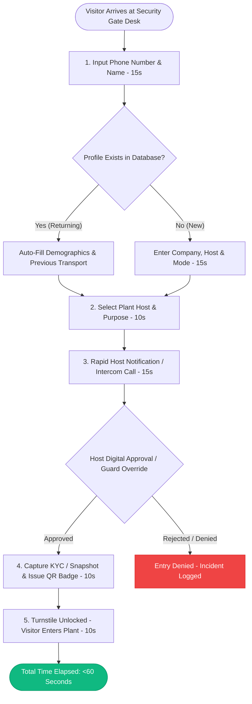

# Walk-In Rapid Gate Flow (<60 Seconds)

## 1. Executive Summary

Manufacturing facility gates handle high peak volumes of unscheduled visitors, emergency maintenance vendors, delivery personnel, and unexpected guests. The **Gate Walk-In Flow** is engineered to complete full registration, host notification, verification, and badge printing in **under 60 seconds** without compromising security or ESG data capture.

---

## 2. Fast-Path Flow Diagram

---

## 3. Minimal Essential Fields

To satisfy the 60-second operational SLA, the Walk-In modal strips non-essential bureaucratic fields and auto-derives values:
1. **Visitor Name**
2. **Mobile Number** (Digits only; serves as instant deduplication key)
3. **Company / Affiliation**
4. **Host Employee** (Quick search dropdown by name or employee ID)
5. **Purpose** (Single-click common presets: `MEETING`, `DELIVERY`, `INTERVIEW`, `MAINTENANCE`)
6. **Transport Mode** (Single-click icon selector: Car, Bike, Auto, Cab, Bus)
   - Auto-derives origin, fuel, and default occupancy from site preset rules if skipped.

---

## 4. Host Fast-Path Approval Channel

When a walk-in is initiated:
1. **Push Alert / SMS / WhatsApp**: Host receives a priority notification containing visitor details and a 1-tap `[APPROVE] / [DECLINE]` interactive link.
2. **Guard Telephone Override**: In environments where hosts are away from their workstation, the security guard can record a phone authorization with mandatory host extension logging.
3. **Emergency Walk-In**: In verified plant emergency situations (e.g. fire response inspectors, safety regulators), authorized Security Supervisors can execute an immediate `EMERGENCY_OVERRIDE` approval with compulsory incident rationale.
