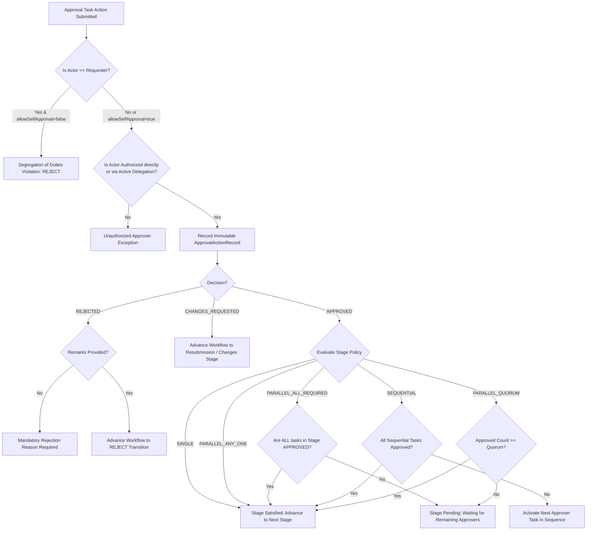

# Enterprise Approval Engine Architecture & Policy Resolution

## 1. Executive Overview

The VMS Enterprise Approval Engine enforces authorization governance across all transaction stages requiring human sign-off. It supports diverse approval models: Single Approver, Multi-Tier Sequential Approvers, Parallel Unanimous (All-Required), Parallel Any-One, and Parallel Quorum.

In addition, it strictly enforces Segregation of Duties (preventing self-approval), requires documented remarks on rejection, and coordinates with the SLA engine for automated escalations.

---

## 2. Multi-Approver Policy Resolution Flow



---

## 3. Supported Approval Policies

### 3.1 Single Approver (`SINGLE`)
- A single named user, host sponsor, or role holder must grant approval.
- An affirmative decision satisfies the stage immediately.

### 3.2 Sequential Multi-Tier (`SEQUENTIAL`)
- Tasks are created with sequential step indices (`stepIndex: 0, 1, 2...`).
- Step 0 is presented to the initial approver (e.g. Corporate Host). Upon approval, Step 1 is activated (e.g. Department Head), followed by Step 2 (e.g. Security Manager).
- All sequential tiers must approve before the stage is satisfied.

### 3.3 Parallel All-Required (`PARALLEL_ALL_REQUIRED`)
- Tasks are dispatched simultaneously to multiple stakeholders (e.g. Plant Director AND EHS Manager AND Security Manager).
- The stage remains pending until 100% of the assigned tasks are affirmatively approved.
- Any rejection immediately rejects the stage.

### 3.4 Parallel Any-One (`PARALLEL_ANY_ONE`)
- Tasks are dispatched to an approval pool (e.g. Any Security Manager on duty).
- The first affirmative decision satisfies the stage and cancels remaining duplicate requests.

### 3.5 Parallel Quorum (`PARALLEL_QUORUM`)
- Requires a configured integer threshold (`quorumRequired: N`) of affirmative votes among an authorized board or committee.
- Once N approvals are logged, the stage is satisfied immediately.

---

## 4. Segregation of Duties (SoD) Invariant
By default, `allowSelfApproval = false`. If an employee creates a visitor pass or contractor work order, they cannot authorize their own request, even if they possess the role assigned to approve that stage. An attempt throws:
```
Segregation of Duties Violation: User 'usr-01' submitted this request and is prohibited from self-approving it.
```
