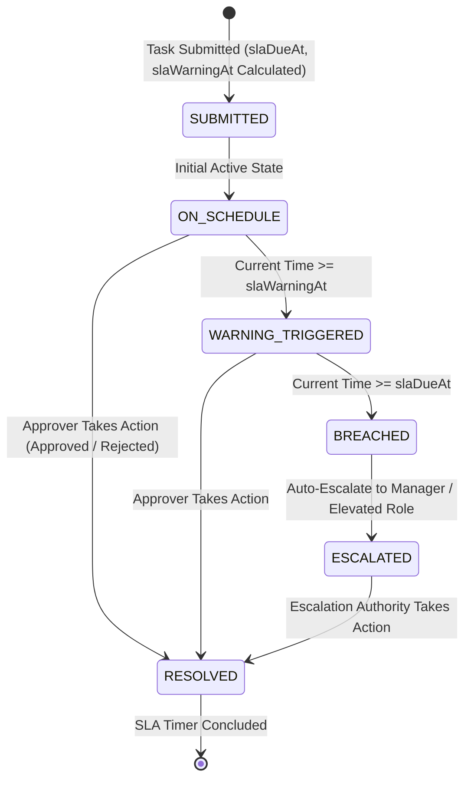
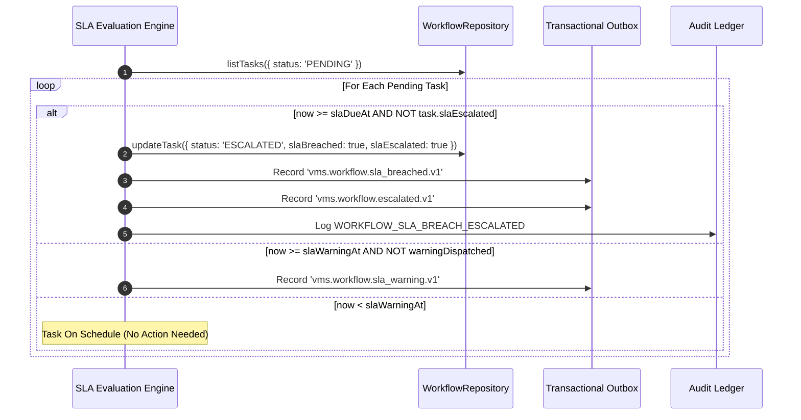

# Service Level Agreement (SLA) & Automated Escalation Engine

## 1. Executive Summary

Operational throughput and facility security require that approvals are not delayed indefinitely. The VMS Enterprise SLA Engine evaluates pending authorization tasks against configured response times, dispatches warning notifications before breach, and automatically escalates delinquent tasks to higher-level authorities or direct managers without duplicate alert flooding.

Crucially, **auto-approval on expiry is strictly prohibited** for safety and security transactions. Expired approvals escalate or fail-safe to human oversight.

---

## 2. SLA Lifecycle & Escalation State Machine

---

## 3. SLA Evaluation Sequence & Alert Deduplication

---

## 4. Operational Invariants

1. **Security Invariant: No Silent Auto-Approvals**:
   In high-risk manufacturing and physical security domains, an expired timer cannot assume an approval. A breached task is marked `ESCALATED`, triggering alerts to the designated manager.
2. **Alert Flood Prevention**:
   The engine flags `slaEscalated = true` and `slaBreached = true` on the task record upon initial breach. Subsequent cron evaluations verify this flag, preventing repeated duplicate notifications for already-escalated tasks.
3. **Escalation Count Tracking**:
   The engine increments `escalationCount` with each hierarchy tier escalation, supporting multi-level escalation policies (e.g. Host -> Department Head -> Site Director).
