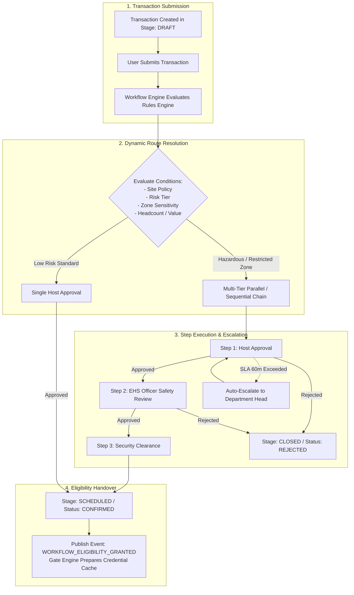

# VMS Enterprise: Workflow & Approval Engine Architecture

## 1. Architectural Mandate: Configurable Decoupled Orchestration

Industrial facilities enforce strict operational, legal, and safety hierarchies before authorizing on-site presence. However, approval requirements vary significantly across organizations and physical sites:
- A corporate headquarters site may allow automatic approval for business meetings.
- A petrochemical refinery site mandates a 3-tier sequential review: Corporate Host -> EHS Safety Officer -> Plant Security Manager.
- A high-value dispatch of returnable dies requires commercial store-keeper clearance and gate pass tax approval.

### Non-Negotiable Invariants:
1. **Zero Hardcoded Approval Logic in UI:** Approval flows must never be hard-coded into frontend pages or controller methods. All approvals execute through the centralized **Workflow Engine**.
2. **Strict Separation: Business Eligibility vs. Physical Gate Access:**
   - *Workflow Engine:* Decides **"Is this transaction administratively and commercially approved?"** (Business Eligibility).
   - *Gate Engine:* Decides **"Can this specific individual, vehicle, or cargo physically traverse this specific turnstile or boom barrier at this exact second?"** (Physical Actuation).
   Business approval is a mandatory prerequisite, but physical entry requires live credential matching, active EHS induction, zone capacity, and zero emergency lockdowns.

---

## 2. Configurable Workflow State Machine Architecture



---

## 3. Workflow Engine Capabilities & Patterns

### 3.1 Supported Execution Topologies
1. **Sequential Approvals (Series):** Step $N+1$ activates only after Step $N$ is affirmatively authorized.
2. **Parallel Approvals (Fork-Join):** Multiple stakeholders (e.g., Commercial Buyer AND Quality Inspector) review concurrently. The step completes when all approvals (`AND` policy) or any single approval (`OR` policy) are received.
3. **Conditional Branching:** The workflow dynamically injects approval nodes:
   - If `VisitorCategory == VIP` $\rightarrow$ Add Protocol Escort step.
   - If `RequiresHotWork == TRUE` $\rightarrow$ Add EHS Safety Permit Sign-off step.
   - If `MaterialPayloadWeight > 30 Tonnes` $\rightarrow$ Add Axle Load Engineering Clearance step.
4. **SLA Timers & Automated Escalations:**
   - Each step configures an explicit SLA threshold (e.g., 120 minutes).
   - If no decision is recorded within SLA:
     - Notification alert sent to primary approver.
     - Delegation proxy activated (e.g., Designated Peer).
     - Upward escalation to Site Department Head.
5. **Out-of-Office Delegation:** Users can configure temporary approval proxies with an immutable audit log linking back to the original delegator.

---

## 4. Workflow Schema Definition

```typescript
export interface WorkflowDefinition {
  workflowId: string;
  tenantId: string;
  siteId: string;
  sourceDomain: 'VISITOR' | 'CUSTOMER' | 'CONTRACTOR' | 'SERVICE' | 'MATERIAL' | 'VEHICLE';
  triggerCriteria: Record<string, unknown>; // JSON-logic expression
  steps: WorkflowStepDefinition[];
  isActive: boolean;
  version: number;
}

export interface WorkflowStepDefinition {
  stepIndex: number;
  stepName: string;
  approverType: 'SPECIFIC_USER' | 'ROLE_BASED' | 'HOST_SPONSOR' | 'DEPARTMENT_HEAD';
  targetRole?: string;
  slaTimeoutMinutes: number;
  escalationRole?: string;
  canReject: boolean;
  requiresDigitalSignature: boolean;
}

export interface WorkflowInstance {
  instanceId: string;
  workflowId: string;
  transactionId: string;
  sourceDomain: string;
  currentStepIndex: number;
  status: 'IN_PROGRESS' | 'APPROVED' | 'REJECTED' | 'EXPIRED' | 'CANCELLED';
  actionHistory: WorkflowActionLog[];
  startedAt: string;
  completedAt?: string;
}

export interface WorkflowActionLog {
  stepIndex: number;
  actorId: string;
  action: 'APPROVE' | 'REJECT' | 'ESCALATE' | 'DELEGATE';
  comment?: string;
  actedAt: string;
}
```

---

## 5. Separation of Business Workflow from Physical Gate Access

To prevent security vulnerabilities, the platform enforces strict structural separation:

| Dimension | Business Workflow Layer | Physical Gate Access Layer |
|---|---|---|
| **Responsible Domain** | Workflow Service (`services/workflow`) | Gate & Access Engine (`services/gate`, `services/access`) |
| **Question Answered** | *"Is the visit commercially, legally, and administratively valid?"* | *"Can this specific person/truck physically pass this barrier right now?"* |
| **Evaluation Input** | PO valid, NDA signed, host confirmed, insurance valid | Gate lane ID, biometric match, active induction, capacity limit, fire alarm status |
| **Execution Speed** | Minutes to hours (Human asynchronous workflow) | Sub-second (<300 ms hardware edge decision) |
| **Network Dependency** | Cloud-native multi-tenant web application | Edge-native, offline-tolerant local gateway cache |
| **Outcome** | Transaction advances to `SCHEDULED / CONFIRMED` | Hardware barrier unlocks or stays locked |
