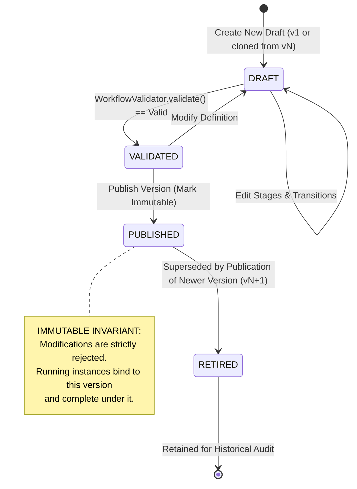
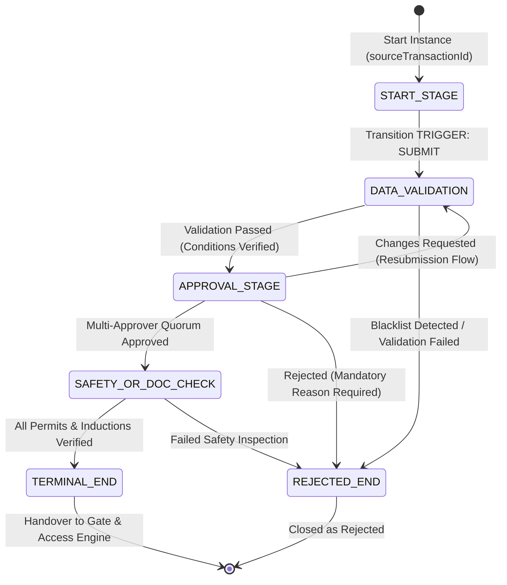

# Declarative Workflow Engine Architecture & Lifecycle Design

## 1. Executive Summary

The VMS Enterprise Workflow Engine provides declarative orchestration for all multi-step business transactions. Workflows are composed of discrete stages (validation, approval, document verification, safety induction, and access decisions) joined by conditional transitions.

Crucially, **domain pipelines remain architecturally distinct** — Visitor, Customer, Contractor, Service, Material, and Gate workflows each follow domain-specific paths rather than being forced into a monolithic universal workflow.

---

## 2. Workflow Version Lifecycle & Immutability State Machine

---

## 3. Workflow Runtime Execution State Machine

---

## 4. Key Architectural Invariants

### 4.1 Immutability of Published Workflows
Once a workflow version is marked `PUBLISHED`:
1. `version.immutable` is set to `true`.
2. Any subsequent invocation of `updateDraftVersion` on that version ID throws an `Immutable workflow violation` error immediately.
3. To alter a workflow, administrators must clone the published version into a new `DRAFT` version (`versionNumber + 1`).

### 4.2 Instance Version Retention
When a transactional instance is initiated:
1. It permanently records `versionId` of the current published version.
2. If an administrator publishes version 2 while an instance is currently undergoing approval on version 1, that instance **continues and concludes execution strictly according to version 1 rules**. This prevents runtime state corruption and orphan stages.

### 4.3 Static Validation Invariants
The engine performs strict static analysis before permitting any workflow to be published:
- **Single START**: Exactly 1 stage of type `START` must exist.
- **Terminal END**: At least 1 stage of type `END` must exist and be reachable from START.
- **Graph Completeness**: All transition source and destination IDs must correspond to valid stages.
- **Dead-End Detection**: All non-END stages must possess at least one outgoing transition.
- **Cycle Safety**: All loops must contain bounded exit conditions to prevent infinite execution traps.
